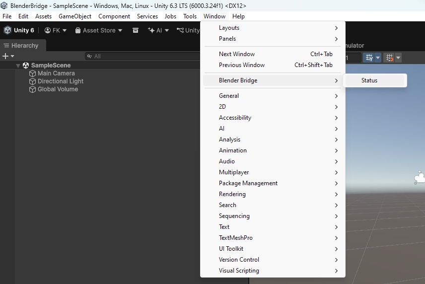
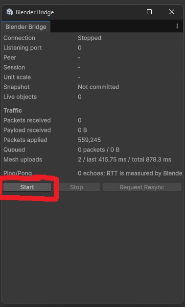
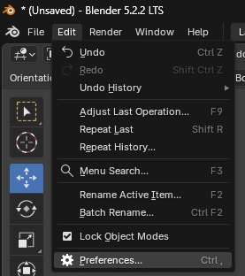
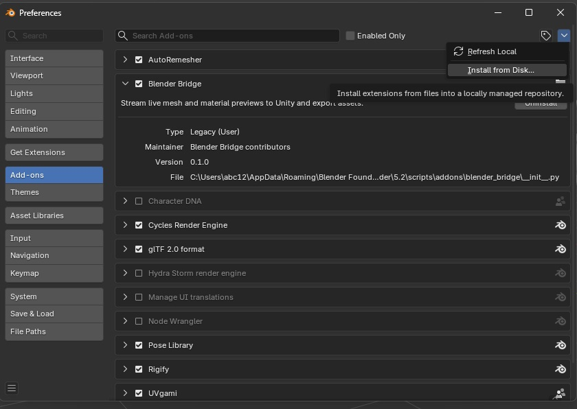
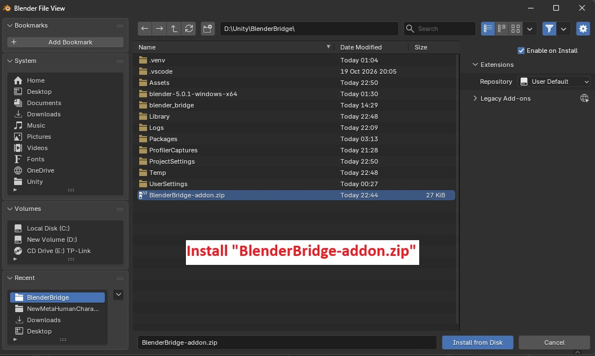
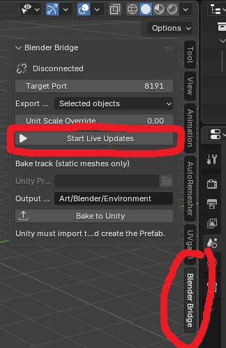

# Blender Bridge

[English](README.md) | [繁體中文](README.zh-HK.md)

Blender Bridge connects Blender to the Unity Editor for live mesh and material previews, and can export selected static meshes as FBX files into a Unity project. Unity imports those FBX files and can bake them into reusable Prefabs with materials.

<video controls width="100%" preload="metadata">
  <source src="images/showcase.mp4" type="video/mp4">
</video>

## Requirements

- Blender 5.0 or newer. The add-on declares Blender 5.0 as its minimum version.
- A Unity Editor project.
- Blender and Unity running on the same computer. The connection uses loopback networking and the default port is `8191`.

## Install

### Unity

1. Copy the `UnityBlenderBridge` folder into your Unity project's `Assets` folder. For example:

   ```text
   MyUnityProject/
   └── Assets/
       └── UnityBlenderBridge/
   ```

2. Wait for Unity to compile the scripts.
3. Open **Window > Blender Bridge > Status**. The Unity server normally starts automatically; if the status is **Stopped**, click **Start**.



The status window shows the connection, listening port, current peer, live objects, and traffic. Keep it open while connecting if you want to monitor the bridge.



### Blender add-on

1. In Blender, open **Edit > Preferences**.
2. Open **Add-ons** (or **Extensions**, depending on your Blender version), then choose **Install from Disk**.
3. Select `BlenderBridge-addon.zip` from this project.
4. Enable **Blender Bridge** in the add-on list if it is not enabled already.
5. In the 3D Viewport, press **N** to open the Sidebar and select the **Blender Bridge** tab.









## Live preview

1. In Unity's Blender Bridge status window, check that the server is listening on port `8191` (or note the configured port).
2. In Blender's **Blender Bridge** Sidebar tab, set **Target Port** to the same port.
3. Choose the live **Export Scope**:
   - **Selected objects** (default): selected meshes and their required ancestors.
   - **Active collection**: meshes in the active collection.
   - **Whole scene**: meshes in the active scene.
4. Leave **Unit Scale Override** at `0` to use Blender's scene unit scale, or enter a positive override.
5. Click **Start Live Updates**. Blender connects to Unity and sends the current scene snapshot; subsequent changes stream while live updates are active.
6. Click **Stop Live Updates** when finished.

The live connection is for previews in the Unity Editor. It does not itself create a saved FBX or Prefab.

## Export an FBX and create a Prefab

1. Connect to Unity and start live updates as described above.
2. In Blender, select the static mesh objects to export. In the Blender Bridge panel, set **Output Path** to a folder under the connected Unity project's `Assets` folder. The default is `Art/Blender/Environment`.
3. Optionally enter a **File Name**; leave it blank to derive the name automatically.
4. Click **Bake to Unity**. The add-on writes an FBX into the Unity project's Assets folder.
5. In Unity, wait for the FBX to import. Select it in the Project window, then choose **Assets > Blender Bridge > Bake FBX To Prefab** from its context menu.

The Unity bake creates a Prefab and materials under the configured Blender Bridge output folder. This export workflow supports static meshes; it does not bake animation.

## Limitations

- Scene and asset updates flow from Blender to Unity only. Unity-side scene edits are not synchronized back to Blender. Unity can send bridge control requests, such as requesting a resync, but this does not provide bidirectional editing.
- Only one Blender connection can be active with a Unity Editor instance at a time.
- FBX baking is limited to static meshes. Rigged or animated meshes, shape keys, and meshes with armature, curve, or particle-system modifiers are not supported by the bake workflow. Save the Blender file before baking.
- The Blender **Bake to Unity** action exports an FBX; Unity must import that FBX and run **Bake FBX To Prefab** separately to create the Prefab and materials.

## Roadmap

The following are potential areas for future development, not commitments or a release schedule:

- Expand export and bake support beyond static meshes, including rigged or animated content.
- Explore bidirectional synchronization so selected Unity-side edits can be sent back to Blender.
- Streamline the FBX import and Prefab creation steps in Unity.

## Settings

By default, Unity listens on port `8191` and uses `Assets/Art/Blender` as the output folder. To customize the Unity port, output folder, or collider behavior, create a settings asset with **Assets > Create > Blender Bridge > Settings**. Keep only one Blender Bridge Settings asset in the project. The Blender target port must match Unity's port, and the FBX output path must be inside the configured output folder for Unity Prefab baking.

## Troubleshooting

- **Blender stays disconnected:** Confirm the Unity status window says **Listening** or **Connected**, and that both sides use the same port. Blender and Unity must run on the same computer.
- **Unity does not start listening:** Check the status window for an error. Make sure the configured port is valid and not already in use.
- **Blender can connect but the preview is empty:** Check the Blender **Export Scope** and ensure it includes mesh objects. For **Selected objects**, select at least one mesh.
- **Bake to Unity is unavailable or fails:** Start live updates first, select static mesh objects, and make sure the output path is within the Unity project's `Assets` folder and configured Blender Bridge output folder.
- **Unity's Prefab bake fails:** Ensure the FBX is imported under the configured output folder and that the project has the **Universal Render Pipeline/Lit** shader available.

## Project contents

- `UnityBlenderBridge/` — Unity runtime and Editor integration.
- `BlenderBridge-addon.zip` — installable Blender add-on.
- `images/` — installation and usage screenshots in this guide.
- `blender_bridge/LICENSE` — MIT license.
